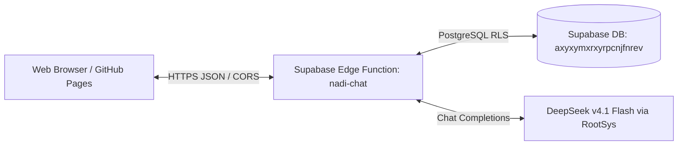

# Zayd — NADI AI Concierge Web UI

[](https://acestraxionweb.github.io/nadi-ai-concierge/)
[-3ECF8E?style=flat&logo=supabase)](https://supabase.com/dashboard/project/axyxymxrxyrpcnjfnrev/functions/nadi-chat/details)
[](https://rootsys.cloud)

> **"Your workflow. AI that fits."**  
> Zayd is the official AI Concierge for **NADI**, an AI systems integration agency that designs and integrates AI agents around your existing business workflows.

---

## 🌟 Key Features

- **Direct Supabase Edge Function Integration**: Directly communicates with the `nadi-chat` serverless Edge Function hosted on Supabase (`axyxymxrxyrpcnjfnrev.supabase.co`).
- **NADI Brand Design Language ("Structured Connection")**:
  - Ink (`#080C10` / `#0E141B`) Onyx dark surfaces with deliberate alignment.
  - Signal Lime (`#C6F36B`) purposeful accents for highlights and CTAs.
  - Typography: Space Grotesk (geometric headers), Inter (body), JetBrains Mono (metrics and code).
  - Official vector and inverted NADI wordmark brand assets.
- **Rich Message Experience**:
  - Full GitHub Flavored Markdown support via Marked.js.
  - Syntax-highlighted code blocks with 1-click copy buttons via Prism.js.
  - Message token count and round-trip execution latency tracking.
- **Session Continuity**:
  - Automatically preserves `conversation_id` across turns so Zayd maintains context across the entire thread.
  - Local session storage with multi-conversation history support.
- **Interactive Speech**:
  - Text-to-Speech (TTS) audio narration toggle.
  - Speech-to-Text (STT) voice input microphone.
- **1-Click Export & Diagnostics**:
  - Export chat transcripts as clean Markdown documents (`.md`).
  - Integrated diagnostics modal to inspect conversation IDs and ping backend health.

---

## 🛠️ Architecture



### API Endpoint Specification
- **URL:** `https://axyxymxrxyrpcnjfnrev.supabase.co/functions/v1/nadi-chat`
- **Method:** `POST`
- **CORS Allowed Origins:** `https://acestraxionweb.github.io`, `https://nadi.framer.website`, `http://localhost:*`
- **Payload:**
  ```json
  {
    "message": "How does NADI integrate AI into existing workflows?",
    "conversation_id": "optional-uuid-to-continue-thread",
    "bot_slug": "zayd"
  }
  ```
- **Response:**
  ```json
  {
    "conversation_id": "83a21c94-6b21-4ed1-a7f5-1b19b69c0d78",
    "reply": "I'm Zayd, the AI Concierge for NADI...",
    "model": "deepseek-v4.1-flash",
    "usage": {
      "input_tokens": 131,
      "output_tokens": 83
    }
  }
  ```

---

## 🚀 Local Development

To run locally with no build steps or bundler required:

```bash
# Option 1: Python HTTP server
python -m http.server 3000

# Option 2: Node npx serve
npx serve -l 3000

# Option 3: VS Code Live Server
# Open index.html and click "Go Live"
```

Then open `http://localhost:3000`.

---

## 🌐 Deployment to GitHub Pages

Hosted at:
👉 **[https://acestraxionweb.github.io/nadi-ai-concierge/](https://acestraxionweb.github.io/nadi-ai-concierge/)**
